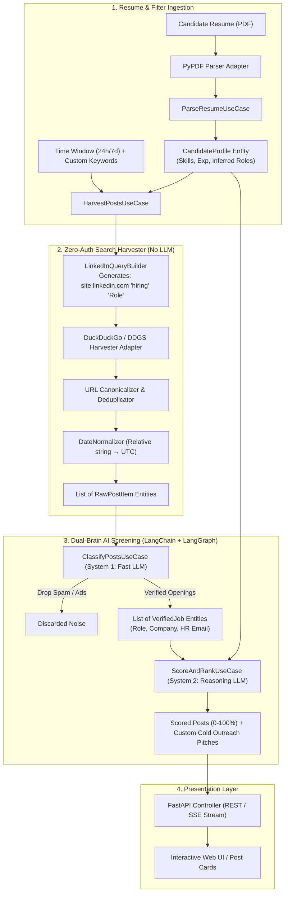

# High-Level Design (HLD) Document
## Project: AI-Powered LinkedIn Job & Internship Hunter Agent

---

### 1. Architectural Style: Clean Architecture (Hexagonal / Ports & Adapters)

The application strictly adheres to Clean Architecture principles:

```
┌────────────────────────────────────────────────────────────────────────┐
│                        INFRASTRUCTURE LAYER                            │
│  (DuckDuckGo Crawler, Gemini/Groq LLMs, SQLite, PyPDF, FastAPI)        │
│                                                                        │
│    ┌──────────────────────────────────────────────────────────────┐    │
│    │                     APPLICATION LAYER                        │    │
│    │  (Use Cases: Harvest, Classify, Score, Parse; Port Protocols)│    │
│    │                                                              │    │
│    │    ┌────────────────────────────────────────────────────┐    │    │
│    │    │                    DOMAIN LAYER                    │    │    │
│    │    │  (Entities: RawPost, VerifiedJob, CandidateProfile;│    │    │
│    │    │   Value Objects: TimeFilter, MatchScore, Email)    │    │    │
│    │    └────────────────────────────────────────────────────┘    │    │
│    └──────────────────────────────────────────────────────────────┘    │
└────────────────────────────────────────────────────────────────────────┘
                    ▲ Dependencies point INWARD only ▲
```

---

### 2. End-to-End System Data Flow



---

### 3. Subsystem Breakdown & Component Contracts

#### Subsystem 1: Search Harvester Subsystem (Non-LLM)
* **Goal**: Collect public post data without logging in.
* **Ports**: `ISearchHarvester`
* **Infrastructure**: `DuckDuckGoSearchHarvester`, `LinkedInQueryBuilder`, `LinkedInUrlCleaner`, `DateNormalizer`.
* **Guarantees**: Strips tracking tags, converts fuzzy dates (`"3h ago"`) to UTC datetimes, deduplicates across query variations.

#### Subsystem 2: System 1 Classifier Subsystem (Gatekeeper)
* **Goal**: Filter out non-hiring noise in <150ms per post.
* **Ports**: `IPostClassifier`
* **Categories**:
  * `GENUINE_HIRING` $\rightarrow$ Passed to System 2.
  * `COURSE_BOOTCAMP_AD` $\rightarrow$ Rejected.
  * `PERSONAL_CELEBRATION` $\rightarrow$ Rejected.
  * `CAREER_ADVICE` $\rightarrow$ Rejected.
  * `SERVICE_PROMOTION` $\rightarrow$ Rejected.

#### Subsystem 3: System 2 Reasoning & Matcher Subsystem
* **Goal**: Evaluate candidate-to-job nuance and craft personalized cold pitches.
* **Ports**: `IPitchGenerator`
* **Input**: `CandidateProfile` + `VerifiedJob`.
* **Output**: Match percentage (0–100%) and a concise 3-sentence application email highlighting candidate's matching projects.

#### Subsystem 4: Local Storage Subsystem ($0 Cost)
* **Ports**: `IPostRepository`
* **Infrastructure**: `SqliteRepository` (Local file `jobs.db`).
* **Schema**:
  * `seen_posts (post_id TEXT PRIMARY KEY, canonical_url TEXT, first_seen_at TIMESTAMP)`
  * `candidate_profiles (id TEXT PRIMARY KEY, skills JSON, target_roles JSON)`
  * `saved_leads (post_id TEXT, status TEXT, pitch TEXT)`

---

### 4. Technical Constraints & Decisions

| Constraint | Decision | Rationale |
| :--- | :--- | :--- |
| **No Paid APIs** | Use Google Gemini Free / Groq Free & DDGS | Fully accessible to users with $0 budget. |
| **No Redis** | Built-in Python `set()` & `sqlite3` | Zero external server setup; runs anywhere with Python. |
| **No Account / Anti-Bot** | Search engine index harvesting | LinkedIn public posts are indexed by search bots without authwalls. |
| **Chronological Precision**| UTC timestamp normalization | Ensures user can filter strictly by "Past 24 Hours". |
